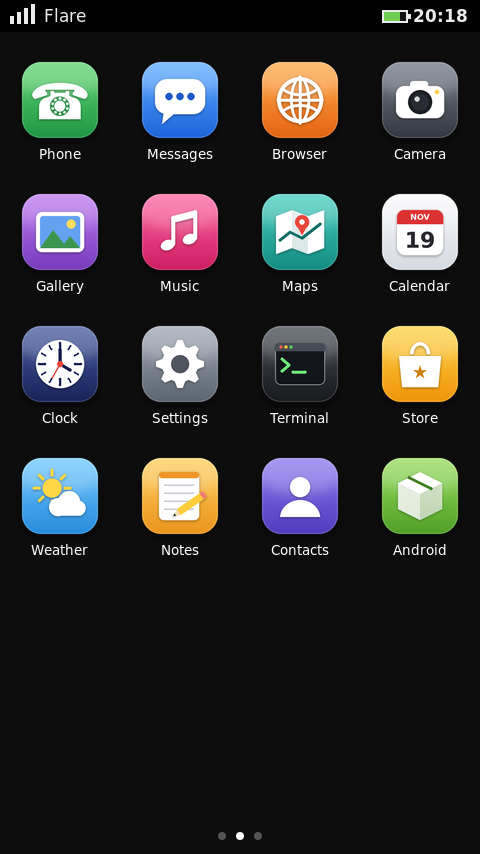

# Flare OS

A modular, capability-secure operating system for phones, with hot-pluggable
hardware components and multiple application compatibility environments.

Flare combines a small privileged **framekernel** (Rust, arm64) with drivers
and services that run as **isolated user-space components**. Components get
**no ambient authority**: everything they can touch — device registers,
interrupts, IPC endpoints, even the console — is an explicit capability
granted by a boot composition. Hardware is described in **FHD** files, so a
phone port is hardware descriptions, driver components and configuration —
not kernel patches.

Status: **M0 and M1 are done; the Linux ABI (M5) and Android apps (M6) run.**

* Unmodified Linux arm64 binaries run on Flare's own kernel, with no Linux kernel underneath. That covers busybox, Rust `std`, dynamic linking and Binder.
* Android apps written in Java and Kotlin run from their APKs, with no Android userspace.
* Real Android apps from F-Droid (such as the Arity calculator) run on ART with Android Translation Layer's framework. They draw natively into Arcan windows in the phone shell.
* Flare boots into a graphical phone shell: Arcan, rendering through Flare's own KMS device, with touch input from user-space drivers.

See [docs/roadmap.md](docs/roadmap.md), [docs/linux.md](docs/linux.md) and
[docs/android.md](docs/android.md) and [docs/display.md](docs/display.md).



## Quick start

Requirements:

* a Rust toolchain (`rustup` installs the pinned target from `rust-toolchain.toml`);
* `qemu-system-aarch64`;
* a JDK (17 or newer), `curl`, `unzip` and `zip`, to build the Android test apps. The Android build tools and the Kotlin compiler are downloaded once and pinned by checksum;
* clang, lld, meson, ninja, cmake, bison, flex, git and python3 with `mako` and `pyyaml`, to build Arcan and Mesa once (see [docs/display.md](docs/display.md)).

```sh
cargo xtask test        # host unit tests + boot the system in QEMU and check its behaviour
cargo xtask run         # boot interactively (type a line when asked; Ctrl-C quits)
cargo fdb shell         # ... and in another terminal: a shell on the running device (docs/fdb.md)
cargo xtask fhd qemu/virt-phone      # validate and show a board's hardware description
cargo xtask cm resolve               # interface wiring and start order of the boot composition
cargo xtask cm swap uart drivers/common/uart-pl011   # plan a hot-swap of a component
```

What the reference system demonstrates when it boots:

```
kernel: started 'uart' (incarnation 0, asid 1, 14 pages, 4 capabilities)
uart-pl011: console service online (incarnation 0, user-space driver)
hello: Hello from a native Flare component 'hello' (incarnation 0)
hello: this line travelled through a derived capability
hello: derived capability revoked -> E_NO_CAP as expected
spinner: starting a CPU-bound loop that never yields
intruder: derive RECV from SEND-only console cap -> denied (E_RIGHTS)
intruder: reading kernel memory at 0x40080000
kernel: component 'intruder' faulted: data abort (permission fault) at 0x40080000, pc 0x20000031c; stopping it
kernel: restarting 'intruder' (1/1)
...
kernel: component 'intruder' retired
flare
hello: received input: flare
flare: system halted after 197 ticks (9 capabilities live, 38 frames in use)
```

* The **UART driver is an unprivileged component**: it owns the PL011
  registers (MMIO capability), receives its interrupt as an IPC notification
  (IRQ capability) and serves `flare.console@1.0` to the other components.
  The kernel log is routed through it too.
* **Capabilities** are checked on every system call; derived capabilities
  can only lose rights and can be revoked through their parent.
* A **misbehaving component** is contained: it is stopped on a fault,
  restarted according to its policy, then retired. Nothing else is affected.
* A component that **never yields** does not stall the system (timer
  preemption on every CPU — the board's 4 cores all run user code).
* **Every device on the board has a user-space driver**: UART console,
  PL031 clock, PL061 power key, virtio-blk storage (with DMA). Drivers are
  **hot-restartable**: the boot test restarts the console and storage
  drivers while clients use them, and nothing is lost.
* **fdb, the Flare Debug Bridge** (like adb): `cargo fdb shell`, `push`/`pull`,
  `run app.apk`, `screenshot`, supervisor control, and `appl` to reload the
  phone shell from an edited Lua file in a quarter of a second. See [docs/fdb.md](docs/fdb.md).
* **A touch phone UI**: Arcan 0.6 with Mesa's software rasterizer runs
  `flarehome`, a Harmattan-style swipe shell, on `/dev/dri/card0` and
  `/dev/input`, which Flare implements over a user-space panel driver (ramfb
  in shared memory) and virtio-input drivers. See
  [docs/display.md](docs/display.md).
* **Android apps (Java and Kotlin) run from their APKs** under `droid`, which has
  its own DEX interpreter and natively implemented Java core and Android API.
  No Android userspace is involved. See [docs/android.md](docs/android.md).
* **Real Android apps, in windows.**
  * ART (the Android runtime) runs with
    [Android Translation Layer](https://gitlab.com/android_translation_layer/android_translation_layer)'s
    framework.
  * A native backend replaces ATL's GTK with cairo, Pango and an Arcan
    window, so unmodified APKs draw in the phone shell and take its touch
    and key input.
  * `atl-run app.apk` starts one. See [docs/android.md](docs/android.md).
* The **Linux personality** boots busybox as pid 1 from an initramfs: shell
  scripts, pipes, fork/exec/wait, files, `/proc`, an interactive shell on the
  console, and a Rust `std` program (heap, files, time, FP, `Command`).

```
linux: started init (pid 1): /bin/sh /etc/rc
rc: uname -a: Linux flare 6.6.0-flare #1 SMP Flare OS framekernel aarch64 Linux
rc: pipeline: 3 words
std-test: child said 'spawned through fork/exec' (status 0)
flare:~# echo shell-$((40 + 2))
shell-42
```

## Repository layout

Follows the illustrative layout of the project specification (§7):

| Path | What |
| --- | --- |
| `kernel/` | The framekernel: boot, MMU, GICv2, timer, frames, address spaces, capabilities, IPC, scheduling, syscalls |
| `interfaces/abi/` | `flare-abi`: the kernel ABI and service protocols — the contract between kernel and components |
| `component-manager/` | `flare-cm`: manifests, interface resolution, lifecycle, hot-swap planning, driver binding, boot compositions |
| `libs/cap/` | `flare-cap`: capability derivation tree with revocation |
| `libs/config/` | `flare-config`: the small TOML-like syntax shared by FHD files, manifests and compositions |
| `libs/rt/` | `flare-rt`: runtime for native components (entry, syscalls, console client) |
| `tools/fdb/` | `fdb`, the debug bridge: host CLI and protocol (device side: `compat/linux/fdbd`) |
| `tools/fhd/` | `flare-fhd`: Flare Hardware Description loader, SoC/board layering, validation, code generation |
| `hardware/soc/…/platform.fhd` | SoC-level hardware descriptions |
| `hardware/boards/…/board.fhd` | Board (phone) descriptions layered over a SoC |
| `drivers/common/` | Driver components (today: `uart-pl011`) |
| `apps/` | Demo native components (`hello`, `spinner`, `intruder`) |
| `kernel/src/linux/` | Linux ABI personality: processes, VFS + initramfs, TTY, ~110 system calls |
| `compat/linux/` | Linux root filesystem content and Linux test programs |
| `compat/arcan/` | Arcan + Mesa build for Flare, the `flarehome` phone shell, `kmstest` |
| `drivers/display/` | Display drivers (today: `ramfb`) |
| `compat/android/` | `droid` (runs APKs without Android userspace), test apps in Java and Kotlin, ART (`art/`), and ATL with Flare's native Arcan backend (`atl/`) |
| `system/` | Boot compositions: which components start, with exactly which capabilities |
| `xtask/` | `cargo xtask` build/run/test driver |
| `docs/` | Architecture contracts and decisions |

## Documentation

* [Architecture](docs/architecture.md) — layers, kernel boundary, boot flow
* [Kernel ABI](docs/abi.md) — system calls, capabilities, IPC, boot info
* [Components](docs/components.md) — manifests, compositions, lifecycle, hot-swap
* [Flare Hardware Description](docs/fhd.md) — the FHD format and porting
* [Linux personality](docs/linux.md) — what runs, what is implemented, what is not
* [Android apps](docs/android.md) — how APKs run without Android userspace
* [Display and the phone shell](docs/display.md) — KMS, touch, Arcan and `flarehome`
* [fdb](docs/fdb.md) — the debug bridge: shell, files, apps, screenshots, UI reload
* [Decisions](docs/decisions.md) — positions taken on the spec's open questions
* [Roadmap](docs/roadmap.md) — milestone status and next steps
