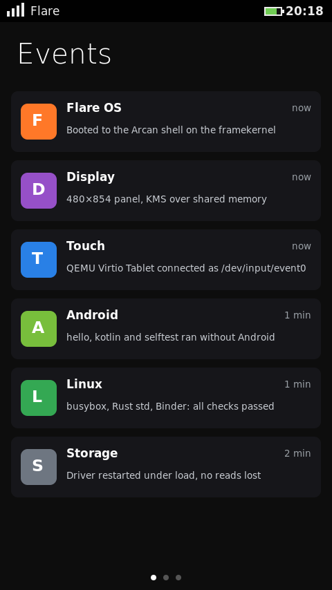

# Display, touch and the Arcan phone shell

Flare boots into a graphical phone shell: **Arcan 0.6** runs a Lua appl,
`flarehome`, with a swipe UI in the style of MeeGo Harmattan:

* a lock screen;
* three views you swipe between: **Events**, **Applications** and **Open applications**;
* apps that open full screen with a zoom;
* an edge swipe that puts a running app away as a live thumbnail.

Arcan, Mesa and the shell are unmodified Linux programs on Flare's Linux
personality. Underneath, the panel and the touchscreen are user-space
drivers, like every other device.

| Lock screen | Applications | Events | An app | Open applications |
| --- | --- | --- | --- | --- |
|  |  |  |  |  |

`cargo xtask test` boots the system, then drives the shell through the
emulated touchscreen: it unlocks, swipes through the views, opens Terminal,
minimises it with an edge swipe, then opens and minimises Phone. It keeps
these screenshots in `target/screenshots/`.

## The stack

```
 flarehome.lua            Arcan appl: lock screen, views, apps, gestures
 arcan (egl-dri, gles2)   composition, text, animation, input
 Mesa 25.1 llvmpipe       GLES2 rendered on the CPU into GBM buffers
 ─────────────── Linux ABI ───────────────
 /dev/dri/card0           Flare KMS device (kernel/src/linux/drm.rs)
 /dev/input/event0, 1     Flare evdev devices (kernel/src/linux/input.rs)
 ─────────────── Flare ───────────────────
 shm:display (4 MiB)      shared memory: header + framebuffer
 ramfb driver             user-space component, scans out the shared memory
 virtio-input drivers     user-space components, one per device
```

### Panel: `drivers/display/ramfb`

QEMU's `ramfb` scans out a framebuffer that lives in guest RAM, configured
through the `etc/ramfb` file behind the fw_cfg interface. The driver holds
three things:

* the fw_cfg registers (MMIO capability);
* one page of DMA memory for fw_cfg commands;
* the `display` **shared memory**.

It points the panel at that memory and publishes the mode in its
`flare.display@1.0` header (`flare_abi::proto::display`): size, stride,
format, physical size and a generation number. The panel is 480×854
portrait, 50×89 mm.

Restarting the driver takes the panel offline and brings it back with the
next generation number, which KMS clients see as a display hotplug.

### Panel on a phone: `drivers/qcom/mdp5-display`

On the Xiaomi Mi A1 the boot loader leaves the panel on, its display engine
(Qualcomm MDP5) scanning a 24-bit splash buffer. The driver finds that
source pipe (as the kernel console does) and re-points it at the `display`
shared memory as 32-bit XRGB8888 with 4352-byte rows. It then publishes
the same `flare.display@1.0` header. The rest of the stack is unchanged.
A command-mode panel is kicked every 33 ms; the Mi A1's are video mode.

Two things only real hardware needs:
* KMS writes each presented frame back from the CPU's data cache
  (`clean_dcache`); the display engine reads memory.
* The kernel's framebuffer console follows the panel into the shared
  memory when the driver brings it online. Once a client presents frames,
  the console stops drawing (a panic draws again).
  `cargo xtask fbcon-test --system system/qemu-virt-fbcon-display.boot.toml`
  checks the move on QEMU with ramfb.

### Shared memory capabilities

`shm:<name>:<size>` is a new grant kind. All grants with the same name map
the same physically contiguous pages, which live as long as the system.
Holders can hand them to devices with `DMA_PADDR`. The composition gives
the display memory to the driver, and `[linux] display = "display"`
exposes it to Linux as a DRM device:

```toml
[component.display]
manifest = "drivers/display/ramfb"
grants = ["fwcfg=mmio:fwcfg0", "dma=dma:4k", "fb=shm:display:4m",
          "display=endpoint:display:recv", "console=endpoint:console:send:badge=8"]

[linux]
display = "display"
```

### KMS: `/dev/dri/card0`

The Linux personality implements the DRM/KMS interface that Mesa and
compositors expect:

* one CRTC, one encoder and one LVDS connector, which follows the driver's
  header (connected / disconnected);
* dumb buffers, which are shared memory objects that can be mmapped and
  exported and imported as PRIME file descriptors;
* legacy modesetting, `ADDFB`/`ADDFB2`, page flips with completion events
  timed to a 60 Hz vblank, `WAIT_VBLANK` and `DIRTYFB`.

A flip copies the buffer into the scanout memory. `kmstest`
(`compat/arcan/tests/kmstest.c`) checks the whole path at boot: GBM, EGL,
GLES2 and three frames presented.

### Touch and keys: `drivers/virtio/input`

The virtio-input driver reads the device's name, ids, event bitmaps and
axis ranges from its configuration space and describes the device to the
kernel. This uses the new `input:<name>` grant and the `INPUT_REPORT`
system call. It then forwards the events from its event queue. They are
already evdev events, so they pass through unchanged.

Each `input:` grant becomes a `/dev/input/eventN` with the usual evdev
interface: `EVIOCGBIT`, `EVIOCGABS`, `EVIOCGNAME`, `EVIOCGID`, grabs and
clock selection. The board has a virtio tablet as its touchscreen and a
virtio keyboard for hardware keys.

## Apps on the launcher

Icons on flarehome's launcher start real programs:

* **Terminal**: Arcan's terminal frameserver (`afsrv_terminal`) running
  `/bin/sh` on a pseudo-terminal, with an on-screen keyboard below it
  (letters, a symbols layer with `|&;$*=()`, Tab, Esc, arrows, and
  Ctrl). The kernel's pseudo-terminals are `/dev/ptmx` and `/dev/pts/N`.
  They provide the console's line discipline (echo, erase, ^C as SIGINT
  to the foreground group), `\n` sent as `\r\n`, raw mode, window size
  with SIGWINCH, and the controlling terminal (`/dev/tty`). The
  `pty` Linux ABI test checks them.
* **Installed apps**: every `/opt/apps/ID.apk` (with `ID.name` and
  `ID.png`). At start, `flare-ui` registers each as an Arcan target
  running `atl-run` on it (`arcan_db add_target`) and lists it in
  flarehome's `installed.lua`. Its icon opens it as a window, with the
  same zoom, minimise and open-applications behaviour as the built-in
  ones. The images carry **Calculator** (Arity 1.27, unmodified from
  F-Droid, pinned by checksum in `xtask`'s `LAUNCHER_APPS`), with its
  icon taken from the APK (`tools/apk_icon.py`). To add an app, add a line
  there; or push one to a running phone and restart the shell:

  ```sh
  cargo fdb push app.apk /opt/apps/myapp.apk
  cargo fdb shell 'echo "My app" > /opt/apps/myapp.name; flare-ui'
  ```

The other icons still open placeholder pages.

## Building Arcan and Mesa

`compat/arcan/build.sh` runs when `cargo xtask build` first needs it, and
again whenever its inputs change (script, lock file, patches), and takes a
few minutes. It cross-builds, with clang:

* **Mesa 25.1.9** with llvmpipe (shaders compiled to native code by
  LLVM 20, linked statically into `libgallium`; each frame split across all
  CPUs) and softpipe: EGL, GBM and GLES2. The sysroot's `llvm-config` is an
  aarch64 program, so `compat/arcan/llvm-config.in` answers for it;
* **Arcan 0.6.3.4** with the egl-dri platform and the GLES2 backend, plus
  four small patches in `compat/arcan/patches`:
  * a prototype mismatch;
  * X11-free EGL native types;
  * a GLES fallback for `glDrawBuffer`;
  * flushing Lua `print` output, so it reaches logs through a pipe.

Both are built against a sysroot of Alpine Linux aarch64 packages. Their
exact versions and SHA-256 sums are in `compat/arcan/alpine.lock`. The
result, about 24 MB with its libraries and the DejaVu fonts, is staged into
the root filesystem.

Host requirements:

* clang, lld and the LLVM binutils;
* meson, ninja and cmake;
* bison, flex and pkg-config;
* git and curl;
* python3 with `mako` and `pyyaml`.

## Kernel changes this needed

Running Arcan and Mesa surfaced gaps that any large Linux program would hit:

* **Kernel heap:** the allocator leaked the tail of every reused large
  block. It now does best-fit with splitting, and frees the most recent
  block back to the bump region.
* **VMAs:** lookups use binary search and free-range search is a single
  pass over the gaps. Before, an `mmap` cost O(n²) in the number of
  mappings, and Mesa's context creation took 2.6 s instead of 0.3 s.
* **EL0 access:** `CTR_EL0`, cache maintenance and `DC ZVA` are allowed at
  EL0 (`SCTLR_EL1.UCT/UCI/DZE`), as on Linux. LuaJIT and Mesa read the
  cache type. EL0 reads of ID registers are emulated, as Linux does.
* **System calls:** `preadv`/`pwritev` and their `v2` forms, plus inotify,
  whose descriptors never fire because device nodes are fixed at boot.

## Performance and limits

* **Large panels at half resolution.** On a panel 1000 pixels or more each
  way (the Xiaomi Mi A1's 1080×1920), KMS offers clients half the size
  (540×960) and doubles every pixel when it presents a frame. Software
  rendering then fills a quarter of the pixels, at the same copy cost.
  `/dev/fb0` stays the panel's own memory, at full size.
* **Frame rate.** Rendering is done on the CPU by llvmpipe, with one
  thread per CPU (8 on the Xiaomi Mi A1). Under QEMU's emulation LLVM
  itself is emulated, so the first frames (compiling shaders) are slow
  there. Animations run in Arcan's logic time, so every frame shows the
  right state. A GPU driver is the next step ([gpu.md](gpu.md)). The shell keeps the
  rasterizer's work down:
  * no full-screen background;
  * covered layers are hidden;
  * nearest-neighbour sampling for 1:1 images;
  * no blending on opaque layers;
  * the wallpaper shader is rendered once into a texture.
* **No audio.** The Arcan build uses its stub audio platform.
* **External app windows.** Native clients connect to the `android`
  connection point (`ARCAN_CONNPATH=android`, in `XDG_RUNTIME_DIR=/tmp`).
  flarehome shows each one as a full-screen app below the status bar, with
  the shell's zoom, edge-swipe minimise and open-applications thumbnail. It
  forwards touches (as Arcan touch events, in window coordinates) and keys
  to the app; edge swipes stay with the shell. Android apps use this through
  `atl-run` (see [android.md](android.md)). Arcan's GLES2 build reads client
  buffers as RGBA bytes, so clients drawing native-endian ARGB swap red and
  blue before signalling a frame. `flare-ui flarehome unlocked` starts the
  shell without the lock screen, for scripted runs.
