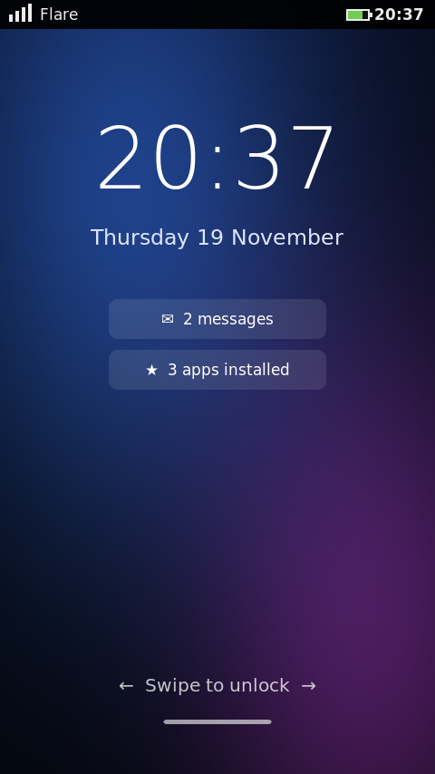
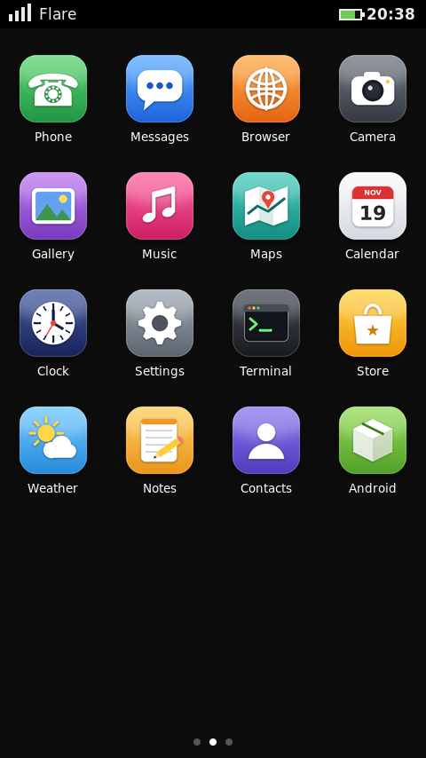
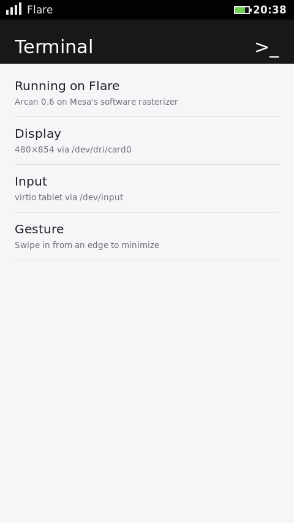
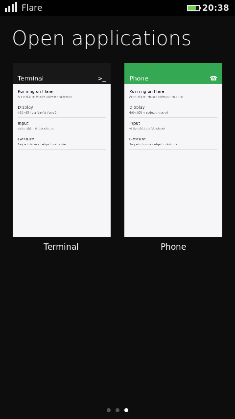

# Display, touch and the Arcan phone shell

Flare boots into a graphical phone shell: **Arcan 0.6** runs a Lua appl,
`flarehome`, with a swipe UI in the style of MeeGo Harmattan:

* a lock screen;
* three views you swipe between: **Events**, **Applications** and **Open applications**;
* apps that open full screen with a zoom;
* an edge swipe that puts a running app away as a live thumbnail.

Arcan, Mesa and the shell are unmodified Linux programs on Flare's Linux
personality. Underneath, the panel and the touchscreen are user-space
drivers, like every other device.

| Lock screen | Applications | Events | An app | Open applications |
| --- | --- | --- | --- | --- |
|  |  |  |  |  |

`cargo xtask test` boots the system, then drives the shell through the
emulated touchscreen: it unlocks, swipes through the views, opens Terminal,
minimises it with an edge swipe, then opens and minimises Phone. It keeps
these screenshots in `target/screenshots/`.

## The stack

```
 flarehome.lua            Arcan appl: lock screen, views, apps, gestures
 arcan (egl-dri, gles2)   composition, text, animation, input
 Mesa 25.1 softpipe       GLES2 rendered on the CPU into GBM buffers
 ─────────────── Linux ABI ───────────────
 /dev/dri/card0           Flare KMS device (kernel/src/linux/drm.rs)
 /dev/input/event0, 1     Flare evdev devices (kernel/src/linux/input.rs)
 ─────────────── Flare ───────────────────
 shm:display (4 MiB)      shared memory: header + framebuffer
 ramfb driver             user-space component, scans out the shared memory
 virtio-input drivers     user-space components, one per device
```

### Panel: `drivers/display/ramfb`

QEMU's `ramfb` scans out a framebuffer that lives in guest RAM, configured
through the `etc/ramfb` file behind the fw_cfg interface. The driver holds
three things:

* the fw_cfg registers (MMIO capability);
* one page of DMA memory for fw_cfg commands;
* the `display` **shared memory**.

It points the panel at that memory and publishes the mode in its
`flare.display@1.0` header (`flare_abi::proto::display`): size, stride,
format, physical size and a generation number. The panel is 480×854
portrait, 50×89 mm.

Restarting the driver takes the panel offline and brings it back with the
next generation number, which KMS clients see as a display hotplug.

### Shared memory capabilities

`shm:<name>:<size>` is a new grant kind. All grants with the same name map
the same physically contiguous pages, which live as long as the system.
Holders can hand them to devices with `DMA_PADDR`. The composition gives
the display memory to the driver, and `[linux] display = "display"`
exposes it to Linux as a DRM device:

```toml
[component.display]
manifest = "drivers/display/ramfb"
grants = ["fwcfg=mmio:fwcfg0", "dma=dma:4k", "fb=shm:display:4m",
          "display=endpoint:display:recv", "console=endpoint:console:send:badge=8"]

[linux]
display = "display"
```

### KMS: `/dev/dri/card0`

The Linux personality implements the DRM/KMS interface that Mesa and
compositors expect:

* one CRTC, one encoder and one LVDS connector, which follows the driver's
  header (connected / disconnected);
* dumb buffers, which are shared memory objects that can be mmapped and
  exported and imported as PRIME file descriptors;
* legacy modesetting, `ADDFB`/`ADDFB2`, page flips with completion events
  timed to a 60 Hz vblank, `WAIT_VBLANK` and `DIRTYFB`.

A flip copies the buffer into the scanout memory. `kmstest`
(`compat/arcan/tests/kmstest.c`) checks the whole path at boot: GBM, EGL,
GLES2 and three frames presented.

### Touch and keys: `drivers/virtio/input`

The virtio-input driver reads the device's name, ids, event bitmaps and
axis ranges from its configuration space and describes the device to the
kernel. This uses the new `input:<name>` grant and the `INPUT_REPORT`
system call. It then forwards the events from its event queue. They are
already evdev events, so they pass through unchanged.

Each `input:` grant becomes a `/dev/input/eventN` with the usual evdev
interface: `EVIOCGBIT`, `EVIOCGABS`, `EVIOCGNAME`, `EVIOCGID`, grabs and
clock selection. The board has a virtio tablet as its touchscreen and a
virtio keyboard for hardware keys.

## Building Arcan and Mesa

`compat/arcan/build.sh` runs when `cargo xtask build` first needs it, and
again whenever its inputs change (script, lock file, patches), and takes a
few minutes. It cross-builds, with clang:

* **Mesa 25.1.9** with only the softpipe rasterizer (no LLVM): EGL, GBM
  and GLES2;
* **Arcan 0.6.3.4** with the egl-dri platform and the GLES2 backend, plus
  four small patches in `compat/arcan/patches`:
  * a prototype mismatch;
  * X11-free EGL native types;
  * a GLES fallback for `glDrawBuffer`;
  * flushing Lua `print` output, so it reaches logs through a pipe.

Both are built against a sysroot of Alpine Linux aarch64 packages. Their
exact versions and SHA-256 sums are in `compat/arcan/alpine.lock`. The
result, about 24 MB with its libraries and the DejaVu fonts, is staged into
the root filesystem.

Host requirements:

* clang, lld and the LLVM binutils;
* meson, ninja and cmake;
* bison, flex and pkg-config;
* git and curl;
* python3 with `mako` and `pyyaml`.

## Kernel changes this needed

Running Arcan and Mesa surfaced gaps that any large Linux program would hit:

* **Kernel heap:** the allocator leaked the tail of every reused large
  block. It now does best-fit with splitting, and frees the most recent
  block back to the bump region.
* **VMAs:** lookups use binary search and free-range search is a single
  pass over the gaps. Before, an `mmap` cost O(n²) in the number of
  mappings, and Mesa's context creation took 2.6 s instead of 0.3 s.
* **EL0 access:** `CTR_EL0`, cache maintenance and `DC ZVA` are allowed at
  EL0 (`SCTLR_EL1.UCT/UCI/DZE`), as on Linux. LuaJIT and Mesa read the
  cache type. EL0 reads of ID registers are emulated, as Linux does.
* **System calls:** `preadv`/`pwritev` and their `v2` forms, plus inotify,
  whose descriptors never fire because device nodes are fixed at boot.

## Performance and limits

* **Frame rate.** Rendering is done on the CPU by softpipe, which under
  QEMU's arm64 emulation manages about one frame per second at 480×854.
  Animations run in Arcan's logic time, so every frame shows the right
  state; the motion in between is lost. On hardware, or with llvmpipe or a
  GPU driver, the same stack runs at full rate. The shell keeps the
  rasterizer's work down:
  * no full-screen background;
  * covered layers are hidden;
  * nearest-neighbour sampling for 1:1 images;
  * no blending on opaque layers;
  * the wallpaper shader is rendered once into a texture.
* **No audio.** The Arcan build uses its stub audio platform.
* **Single process.** Arcan's frameservers (external clients) are built but
  not used by the shell. Apps in the launcher are placeholders drawn by
  the shell. Running Android apps from `droid` in a window is the obvious
  next step.
